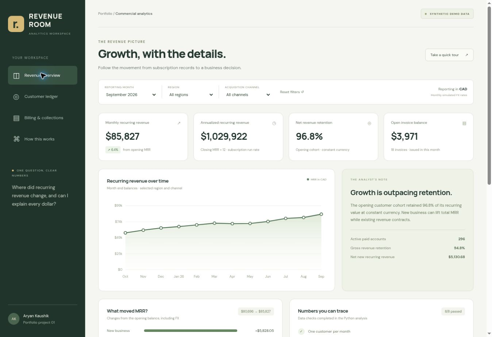

# Analytics portfolio

I use these projects to work through business questions with Python, SQL and clear reporting. Each project includes the data assumptions, code, checked results and a walkthrough of how it works.

## Projects

| # | Project | Question |
| --- | --- | --- |
| 01 | [SaaS Revenue Control Room](projects/01_saas_revenue_control_room) | What changed recurring revenue, and can I trace it to the source records? |
| 02 | [Marketing Lift and Experiment Lab](projects/02_marketing_lift_experiment_lab) | Did a campaign create enough extra conversions to cover its cost, and can I trust the comparison? |
| 03 | [Fraud Decision Desk](projects/03_fraud_decision_desk) | Which transactions should enter a limited fraud-review queue? |
| 04 | [Ask Your Metrics](projects/04_ask_your_metrics) | Can a business question stay tied to an approved definition, inspected SQL and a verifiable result? |
| 05 | [Merchant Pricing and Profitability](projects/05_merchant_pricing_profitability) | How do pricing options change merchant cost and contribution margin? |

The first project includes an executed notebook, SQL models, an interactive browser dashboard, source data, findings and verification notes. Its generated scenario covers 360 fictional accounts. No employer or customer data is included.

The marketing project works through three authored synthetic experiments. It includes an executed notebook, matching Python script, SQLite query, interactive dashboard and a case where assignment problems block the recommendation. Its financial scenarios are assumptions, not realized advertiser results.

The fraud project uses 60,000 authored synthetic transactions to compare review thresholds under a daily capacity limit. It includes a chronological model evaluation, an executed notebook, SQL queue logic, a decision dashboard and transparent cost assumptions. It is a retrospective demonstration, not a live fraud system.

Ask Your Metrics is a governed offline question interface. It selects from approved metric queries, shows the SQL and parameters, and stops when a request is unclear or unsupported. The hosted browser version replays checked outputs; it is not a live language-model or production-database integration.

Merchant Pricing and Profitability compares three hypothetical price structures across 360 synthetic merchants. It separates fee revenue from payment costs, recomputes weighted rates from totals and tests cost and volume sensitivity. The rates and business responses are assumptions, not a real provider schedule or forecast.

## More work

The [roadmap](ROADMAP.md) lists the remaining projects. Entries marked planned are ideas for future work, not completed projects.

I keep the question, calculation and interpretation together. A useful result should be reproducible and explainable, including the limitations. Each project README provides its own setup instructions and data licence details.

