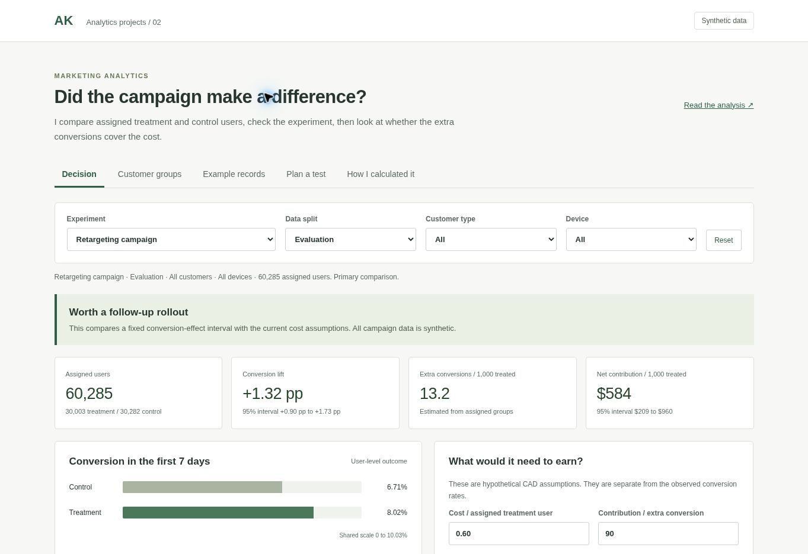

# Marketing Lift and Experiment Lab

I wanted to answer a practical campaign question. Did the advertising create enough extra conversions to cover its cost, and can I trust the comparison?

This is a personal project with three **synthetic randomized experiments**. I work from assignment and purchase records to user-level outcomes, compare treatment with control, check uncertainty and put the result into a cost scenario. A deliberately broken experiment shows when the answer should stop at a data-quality problem.

## 1. What I found

The main campaign has 60,285 evaluation users. Treatment conversion is 8.02%, compared with 6.71% for control. That is **+1.32 percentage points**, with a 95% interval of **+0.90 to +1.73 points**.

At the hypothetical assumptions of CAD 0.60 per assigned treatment user and CAD 90 contribution per extra conversion, the estimated net contribution is CAD 584 per 1,000 treated users. Its interval runs from CAD 209 to CAD 960. That supports a measured follow-up rollout within this fictional scenario.

The smaller test does not establish a conversion effect. Its interval crosses zero. The missing-controls experiment is blocked because the assignment ratio is wrong and some purchase users have no assignment record. I withhold its campaign recommendation.

These are measured outputs from synthetic data. They are not advertiser results or realized financial returns.



## 2. Open the work

- [Interactive dashboard](https://aryan-marketing-experiment-lab.arz2389.chatgpt.site) · owner-private preview
- [Executed notebook](experiment_analysis.ipynb)
- [Readable HTML analysis](dist/analysis.html) · open through a local server or the hosted dashboard
- [Matching Python script](experiment_analysis.py)
- [Control-by-control walkthrough](docs/walkthrough.md)
- [Findings and recommendation](docs/findings.md)
- [Interview explanation](docs/interview_explanation.md)

The source and all fictional data are included. There are no API keys or paid services required.

## 3. Run it locally

Use Python 3.11 or later. The analytical dependencies are listed in requirements.txt. Node 20 or later is only needed for the dashboard calculation tests.

```bash
python -m pip install -r requirements.txt
python generate_data.py
python analysis.py
python -m unittest discover -s tests -v
python tools/make_notebook.py
python experiment_analysis.py
node tests/check_dashboard.mjs
python -m http.server 8000 --directory dist
```

Open http://localhost:8000 . The dashboard needs an HTTP server to load data.json. Opening index.html directly from the filesystem can block that request.

The notebook builder executes its cells in a fresh Python namespace and captures actual stdout and matplotlib figures. It does not launch an external Jupyter kernel. The saved notebook is standard nbformat 4 and can also be opened in Jupyter or Colab. The matching script ran in a separate Python process and produced the same printed output.

## 4. How it works

1. Generate assignment records, ad-exposure flags and purchase events with seed 89.
2. Remove identical assignment and event re-deliveries.
3. Keep one outcome per assigned user, including people with no purchases or no ad exposure.
4. Count purchases in the first seven days after assignment. Several purchases still count as one converted user.
5. Verify the same user outcomes in SQLite and pandas.
6. Check allocation and missing assignment records before interpreting a campaign effect.
7. Use the evaluation split for the main comparison. Choose one customer group using development data only.
8. Compute a Newcombe-Wilson interval for the conversion-rate difference and translate it into a hypothetical contribution interval.

The dashboard uses the checked aggregate counts. Its filters, metric cards, charts and exports share the same selection. User examples are a small fixed tracing sample and are not used to estimate lift.

## 5. Files

| File or folder | What it contains |
| --- | --- |
| generate_data.py | Authored scenario generator and edge cases |
| data/ | Fictional assignment deliveries, purchase events and scenario assumptions |
| analysis.py | User outcomes, intervals, quality checks, cost rules and dashboard data |
| sql/user_outcomes.sql | Executed SQLite user-outcome query |
| experiment_analysis.ipynb | Executed learning notebook with actual tables and charts |
| experiment_analysis.py | The same sequential analysis as a Python script |
| dist/ | Browser dashboard and readable HTML analysis |
| outputs/ | Aggregate counts, checks, filter results, charts and execution evidence |
| tests/ | Python checks and Python-to-JavaScript comparisons |
| docs/ | Brief, definitions, data dictionary, findings, walkthrough and build journal |

## 6. Checks and limits

The release includes 10 structural data checks, 22 Python tests and 54 Python-to-JavaScript filter comparisons, plus seven boundary checks. Browser checks covered navigation, filters, development-only messaging, cost sensitivity, invalid inputs, the blocked experiment, record details, empty search, planning and actual downloaded CSV contents. See [the journal](docs/implementation_journal.md) for the execution method and layout checks.

All data is synthetic. I checked Criteo's public source and corrected v2.1 download, but the download was unavailable from the build environment. **No Criteo records are included or analyzed.** That benchmark extension remains deferred. See [data sources and terms](docs/data_sources.md).

The intervals assume independent users. Device slices and unselected groups are exploratory. I have not established a statistical interaction between customer types. The money inputs are assumptions, and their own uncertainty is not included. There is no live ad-platform feed or attribution integration.

The dashboard is browser-only HTML, CSS and JavaScript. It can later be placed on GitHub Pages with its interactive controls intact. The Python analysis runs separately to regenerate its data. The personal portfolio website has not been changed.

Original code and authored synthetic data use the MIT licence in this folder. External documentation and any future public dataset retain their own terms.
